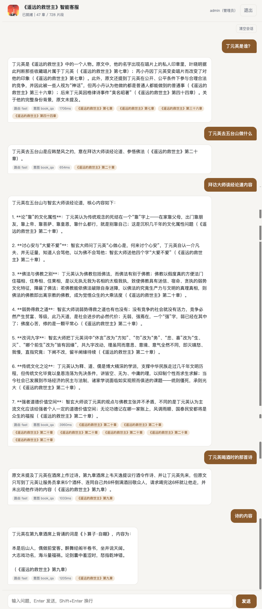

# 《遥远的救世主》单书智能客服

> 一本长篇小说的「资料查询型」智能客服：**有理有据、不编造**。
> 答案必须能被原著片段支撑，找不到依据就拒答并建议转人工，而不是用通用知识圆场。

[](https://www.python.org/)
[](LICENSE)
[](https://github.com/<owner>/<repo>/actions)
[](https://github.com/psf/black)

🌐 **在线体验**：[https://cs.brandex.top](https://cs.brandex.top/?from=github_readme)
- 入口链接带 `from` 参数，用于识别来源（`from=github_readme` / `github_badge` / `github_issue`），管理员可在 `/admin` 查看访问来源与「GitHub 来源提问」
- 体验账号：`jerry` / `change-me-extra`（普通用户，可对话，不能查看管理页）
- 管理页 `/admin` 与统计 `/events/stats` 仅管理员可访问

---

## 这个项目展示什么

不是套模板调 API 的玩具 demo，而是一条**完整的 RAG 工程链路**：

| 能力 | 实现 |
|---|---|
| 有据判定 | 双通道检索（BM25 + 本地向量）→ RRF 融合 → **IDF 加权覆盖率门控**，不足即拒答 |
| 反幻觉 | 引文 / `[E]` 引用编号 / 专名 / 数字四类**纯代码校验**，修复只做减法 |
| 复杂推理 | LangGraph **双环 Agent**（补证据环 + 修答案环），硬上限 5 次调用 / 15 步 |
| 成本控制 | 本书简介 ~12ms / 0 次模型，单章摘录 0 次模型，FAQ / 购买引导 0 次模型 |
| 产品闭环 | SSE 流式对话、登录会话（60 分钟）、admin/user 双角色、只读管理页 |
| 运营能力 | 展示 / 点击分流与点击率；入站来源识别（`from` / UTM / Referer）、PV/UV 与来源提问归因 |

## 效果样例

| 问题 | 路径 | 表现 |
|---|---|---|
| 本书简介 | book_intro 快路径 | 档案 + 目录拼装，约 12ms、0 次模型调用 |
| 第一章讲了什么？ | chapter 结构导航 | 按章节元数据精确定位，引文为《遥远的救世主》第X章 |
| 丁元英是谁？ | book_qa | 覆盖率 1.0 判为有据，带出处 |
| 对比丁元英和韩楚风 | compare | 人物档案注入 + 差异分析 |
| 这本书的主线讲了什么？ | plot | 全章等间隔抽样拼故事脊柱 |
| 丁元英的孩子后来考上大学了吗？ | 拒答 | 覆盖率 0.45 < 阈值 → 拒答转人工，不编造 |



一次多轮对话的实际效果：回答带原文出处与来源徽标，价格类问题走 FAQ 快路径，超出语料的问题明确拒答。

## 技术架构

```
浏览器 ──HTTPS──► FastAPI（登录 Cookie / SSE / 鉴权中间件）
                       │
              ChatPipeline：会话 → 意图路由 → 快路径 / LangGraph Agent
                       │
        ┌──────────────┴───────────────┐
      策略层                          生成层
   路由·门控·校验                快路径·LLM·向量编码
        └──────────────┬───────────────┘
                       │
              检索层：BM25 + bge-small-zh 向量 → RRF → 覆盖率门控
                       │
              数据层：SQLite（会话 / 事件）+ 持久化索引（Volume）
```

**技术栈**：FastAPI · LangGraph · LangChain · rank_bm25 · fastembed（BAAI/bge-small-zh-v1.5，本地推理）· jieba · SQLite · Docker Compose

更完整的架构分析见 [docs/phase1-report.md](customer_service/docs/phase1-report.md)。

## 快速开始

> 语料受版权保护，本仓库**不包含**小说全文。运行前需自行放置。

```bash
git clone https://github.com/<owner>/<repo>.git
cd <repo>/customer_service

python3 -m venv .venv && source .venv/bin/activate
pip install -r requirements.txt

cp .env.example .env          # 填入 DEEPSEEK_API_KEY、CS_AUTH_PASSWORD 等

# 把小说全文放到 data/corpus/遥远的救世主.txt
# （首次运行会自动构建索引；改了语料用 --rebuild 强制重建）

python run_service.py --reload    # 打开 http://127.0.0.1:8000
```

命令行单问：

```bash
python run.py -q "本书简介"
python run.py --rebuild -q "第一章讲了什么？"
```

Docker：

```bash
docker compose up -d --build      # 需在 docker-compose.yml 中挂载语料与 .env
```

## 项目结构

```
customer_service/
├── app/            # HTTP 服务、编排流水线、前端静态页、评测
├── agent/          # LangGraph 状态图、工具、双环控制
├── core/           # 配置、会话存储、登录令牌
├── retrieval/      # 语料切分、BM25/向量索引、RRF、覆盖率门控、知识库
├── policy/         # 意图路由、范围守卫、提示词、答案校验
├── generation/     # LLM 封装、快路径、查询改写、向量编码
├── data/           # FAQ / 人物档案（语料需自行放置，不入库）
├── tests/          # 97 个用例
├── run.py          # CLI 入口
├── run_service.py  # HTTP 服务入口
└── docs/           # 项目总结与技术架构分析
```

## 测试

```bash
cd customer_service
PYTHONPATH=.. python -m pytest tests -q
# 96 passed, 1 skipped（依赖大模型的用例在未配置 Key 时自动跳过）
```

## 版本

见 [CHANGELOG.md](customer_service/CHANGELOG.md) 与 [Releases](https://github.com/<owner>/<repo>/releases)：`v0.1.0` → `v0.2.0` → `v0.3.0`。

## 路线图（v0.4.0）

- 全量 50 条评测基线 + 反幻觉诱饵集
- 出处强制（citation presence）、人物关系断言、问错对象识别
- 多书路由、历史会话、停止生成

## 许可

MIT License — 见 [LICENSE](LICENSE)。
注意：小说原文版权归原作者所有，本项目仅提供检索与问答框架，不包含受版权保护的语料。
